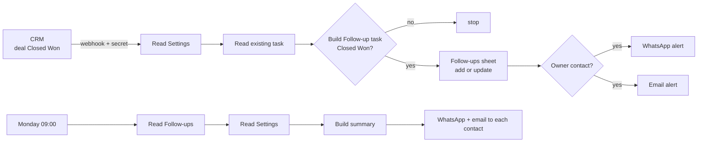

# How it works

## The flow

All the business rules live in one file, `handoff.js`. `build.js` copies it into the workflow's Code nodes, so the
rules that are tested are the same ones that run.

## Follow-up due rule

Working days are Monday to Friday. Public holidays are ignored for now.

| Deal closes | Follow-up due |
|---|---|
| Monday–Thursday | 12:00 IST the next day |
| Friday | 12:00 IST the following Monday (weekend skipped) |
| Saturday or Sunday | 12:00 IST the following Monday |

All times are India time (IST), computed explicitly. n8n's code runner keeps time in UTC even when the server is set
to IST, so the code never relies on the server clock's timezone.

## Flags

A task is always written, even when something is wrong, and the problem is spelled out in the `Flags` column and the alert:

| Flag | Meaning |
|---|---|
| `Missing: lead id, sales owner` | Required fields the CRM didn't send at Closed Won |
| `Closed on a weekend → Monday slot` | The deal closed Saturday or Sunday |
| `No owner set for team Enterprise` | Nobody in Settings to alert, so the row is written without a message |

## When the same deal comes in again

The workflow matches on the CRM's lead/deal ID.

- **It updates the row** and sends an alert starting with `Updated:`.
- **The Status is never overwritten.** A deal marked `Contacted` stays `Contacted`.
- **Waiting time counts from the first arrival**, not the latest edit.

## Weekly summary

- **Who it covers:** only open tasks (`New`).
- **What it counts:** follow-ups due in the next 7 days, overdue follow-ups, and tasks with no owner set.
- **Who's at the top:** the three tasks waiting longest.

It goes to every owner listed in Settings, as the agenda for the weekly review.

## What's real and what's sample

- **Real:** the workflow, the rules, and their tests (same engine as a prior real deployment — see git history).
- **Sample:**
  - Every lead is invented. `send-test.sh` posts a generic CRM-shaped lead.
  - The field names in `fromCrm()` are a starting point for five common CRMs (see [the mapping](crm-mapping.md)), not
    confirmed against any specific client yet. Capture one real webhook payload before going live.
  - WhatsApp uses Meta's free test number pattern from the original deployment. In production it would go through a
    WhatsApp provider such as WATI (`n8n-nodes-wati`, Send Template Message) with an approved message template.

## Files

| File | What |
|---|---|
| `handoff.js` | All rules: CRM field mapping, follow-up due date, flags, alert text, weekly summary |
| `handoff.test.js` | Fixed-date checks for every rule (`node handoff.test.js`) |
| `build.js` | Builds `workflow.json` with `handoff.js` inlined into the Code nodes |
| `workflow.json` | Import into n8n (no credentials inside) |
| `payloads/`, `send-test.sh` | Sample CRM leads and the script that sends them |

## Build status

| Part | State |
|---|---|
| Rules (follow-up due date, flags, weekly summary) | Built and tested, in Node and inside n8n |
| Workflow in n8n | Built, generic CRM webhook with a secret header |
| Email alerts + Google Sheet end-to-end | Logic tested (`node handoff.test.js`); not yet run against a live Sheet/Gmail for this generic version |
| WhatsApp alerts | Wired, same pattern as the original deployment; needs a WhatsApp Business account with billing to actually send |
| A real CRM connection | Sample payloads only — see [the field mapping](crm-mapping.md). Capture one real webhook payload per client and adjust `fromCrm()` |

The weekly review runs every Monday at 09:00 IST. Ops/Sales closes the loop in the Sheet by changing Status:
`New → Contacted`.
